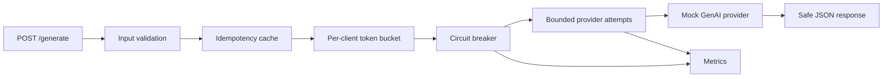

# Resilient GenAI Gateway Lab

[](https://github.com/abedk21/resilient-genai-gateway/actions/workflows/ci.yml)

A **localhost-only Python API gateway demonstration** focused on practical reliability patterns for Generative AI services: retries, rate limits, circuit breakers, request idempotency, input validation, and redacted operational reporting.

> **Honest scope:** this lab uses a **mock GenAI provider**, not a production model endpoint. It never calls Google Cloud or any external service. The in-memory controls deliberately favor testability over distributed scale and are **not production security controls**.

## Architecture



### Demonstrated engineering skills

- **Bounded retries:** up to three provider attempts by default. Provider-recommended retry delays are capped; permanent failures aren't retried.
- **Circuit breaker:** closed/open/half-open states, failure threshold, cooldown, and a half-open recovery probe.
- **Per-client throttling:** in-memory token bucket with configurable refill rate.
- **Idempotency:** client-scoped keys, request fingerprints, replay cache, and `409` on conflicting key reuse.
- **Sensitive-data discipline:** no prompt text, credentials, or raw provider exceptions are included in the metrics or error payloads.
- **HTTP API:** small JSON API, explicit payload size limits, loopback-only binding.
- **Observability:** request/attempt/retry/failure counters and breaker-state endpoint without prompt storage.
- **Reproducibility:** injected clock and sleep functions make time-based failure scenarios easy to test.

## Run locally

**Python 3.11+; standard library only, no API key needed.**

Start the server:

```bash
python run_server.py --port 8765
```

From a second terminal:

```bash
curl http://127.0.0.1:8765/health
curl http://127.0.0.1:8765/metrics
curl -X POST http://127.0.0.1:8765/generate \
  -H 'Content-Type: application/json' \
  -d '{"prompt":"Synthetic troubleshooting example","client":"demo","idempotency_key":"sample-1"}'
```

Windows PowerShell equivalent:

```powershell
Invoke-RestMethod http://127.0.0.1:8765/health
$body = @{prompt='Synthetic troubleshooting example'; client='demo'; idempotency_key='sample-1'} | ConvertTo-Json
Invoke-RestMethod http://127.0.0.1:8765/generate -Method Post -ContentType 'application/json' -Body $body
```

The response confirms a mock result (`"model": "synthetic-mock"`). Repeat with the same key to see `"cached": true`. Set prompt to `[SIMULATE_429]` to explore a bounded retryable error, or `[SIMULATE_400]` for a non-retryable provider rejection.

Run all unit and real local-HTTP integration tests:

```bash
python -m unittest discover -s tests -v
```

## HTTP API

| Endpoint | Method | Behavior |
| --- | --- | --- |
| `/health` | GET | Local demo health |
| `/metrics` | GET | Aggregate counters and breaker state |
| `/generate` | POST | Bounded mock generation; accepts `prompt`, `client`, and optional `idempotency_key` |

Mocked provider responses are deliberately **not based on the user's prompt**. The purpose is to make failure-handling architecture and tests visible, not to simulate model intelligence.

## Limitations & security

- No authentication, TLS, distributed state, durable idempotency, provider credential management, token accounting, or real model inference. **Never expose this server beyond 127.0.0.1.**
- Because the demo serializes dispatch under a lock, it is not a concurrency-performance benchmark.
- Per-client identity is caller-supplied and not trustworthy. Production gateways need authenticated identity, robust quotas, managed stores, tracing, and appropriate privacy controls.
- Exponential retry is deterministic to make tests easy to inspect; real multi-worker deployments need randomized jitter.
- Request content is held transiently in process memory, not written to application logs; production systems need stronger controls.

### Possible next step

Add a separately permissioned Google Gemini or Vertex AI provider adapter with explicit opt-in, secrets via environment/secret manager, authenticated callers, observability, and safe evaluation datasets. Keep the mock default to ensure CI remains deterministic.

Licensed under the MIT License; see [LICENSE](LICENSE).
